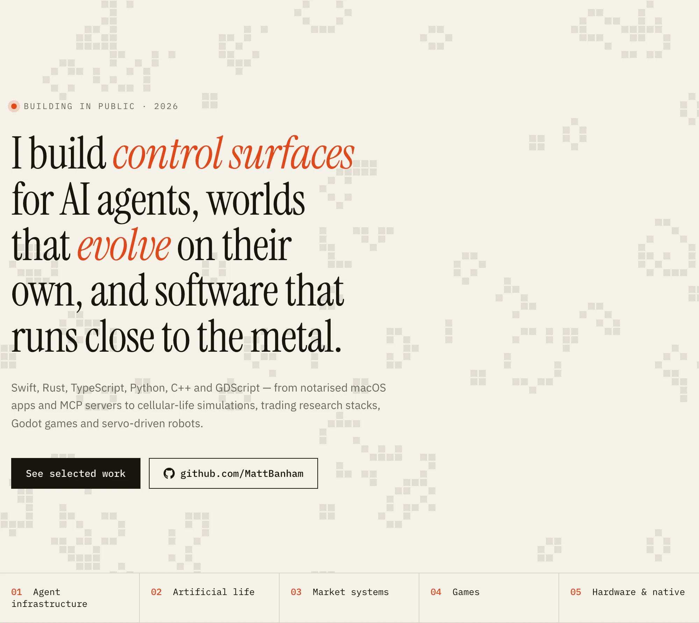
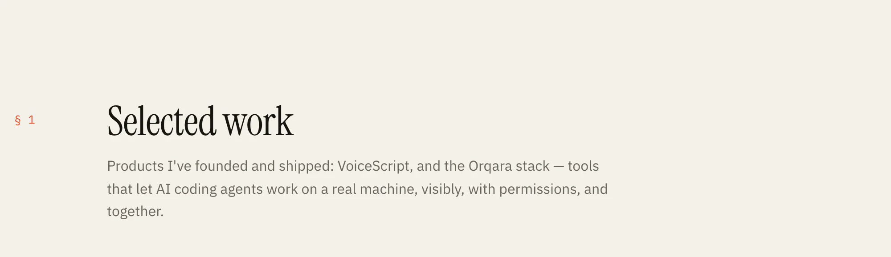
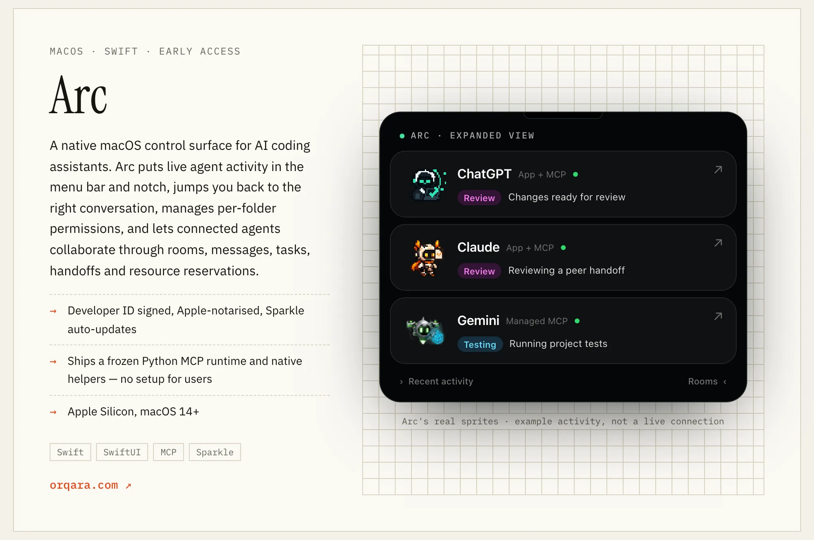
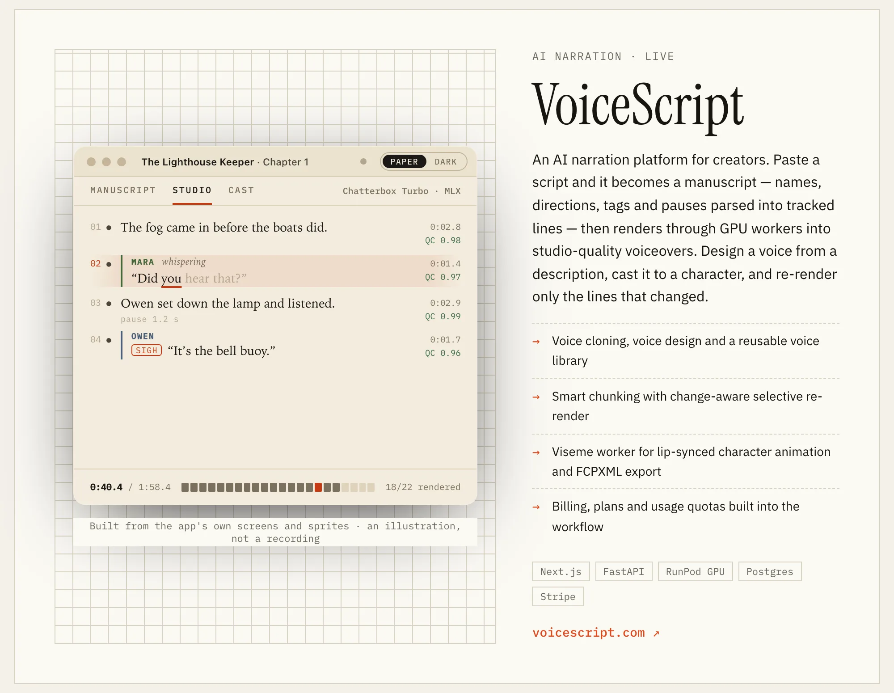
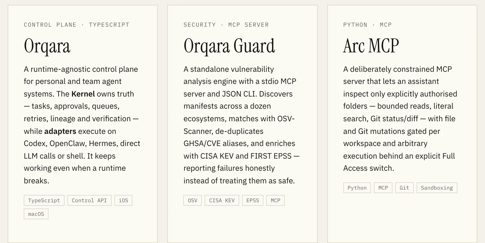
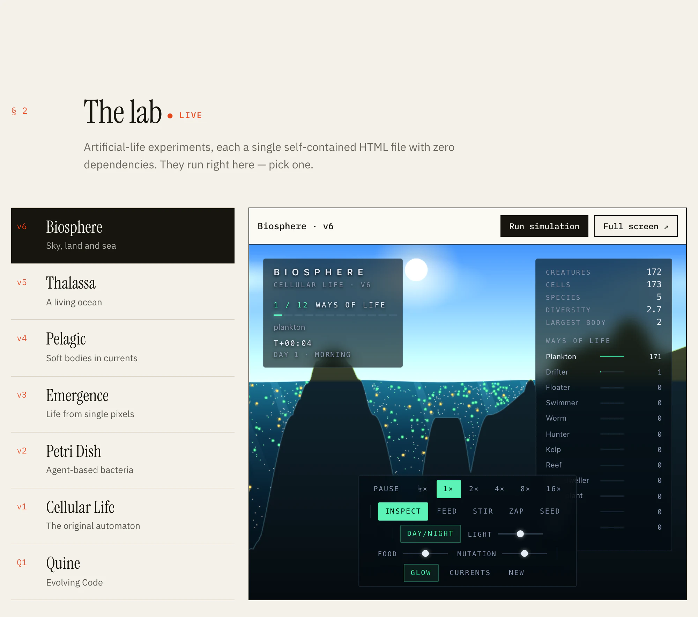
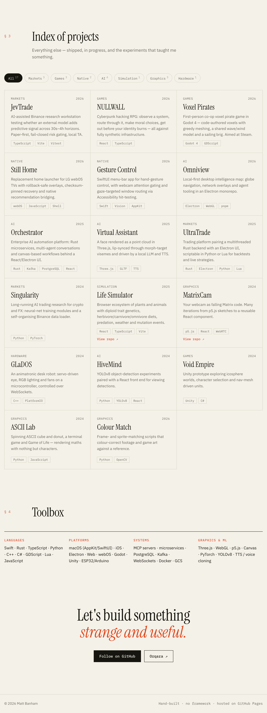

<!-- Each section is rendered from https://mattbanham.github.io (light and dark). Rebuild with the capture script in tools/. -->

<a href="https://mattbanham.github.io"><picture><source media="(prefers-color-scheme: dark)" srcset="assets/hero-dark.webp"></picture></a>
<a href="https://mattbanham.github.io/#work"><picture><source media="(prefers-color-scheme: dark)" srcset="assets/work-dark.webp"></picture></a>
<a href="https://orqara.com"><picture><source media="(prefers-color-scheme: dark)" srcset="assets/arc-dark.webp"></picture></a>
<a href="https://voicescript.com"><picture><source media="(prefers-color-scheme: dark)" srcset="assets/voicescript-dark.webp"></picture></a>
<a href="https://orqara.com"><picture><source media="(prefers-color-scheme: dark)" srcset="assets/orqara-dark.webp"></picture></a>
<a href="https://mattbanham.github.io/#lab"><picture><source media="(prefers-color-scheme: dark)" srcset="assets/lab-dark.webp"></picture></a>
<a href="https://mattbanham.github.io/#index"><picture><source media="(prefers-color-scheme: dark)" srcset="assets/more-dark.webp"></picture></a>

<a href="https://mattbanham.github.io">mattbanham.github.io</a> · <a href="https://matt-os.com">matt-os.com</a> · <a href="https://voicescript.com">voicescript.com</a> · <a href="https://orqara.com">orqara.com</a> · <a href="https://x.com/mabanham">@mabanham</a>

