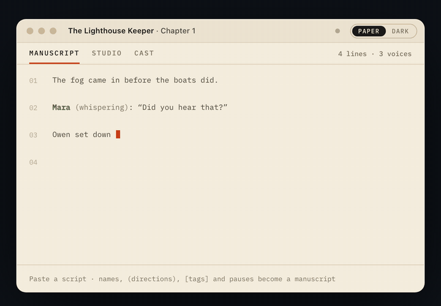
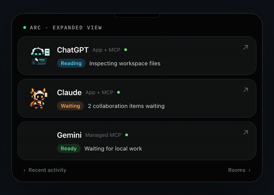

<h1>Hi, I'm Matt 👋</h1>

I build **control surfaces for AI agents**, **worlds that evolve on their own**, and software that runs close to the metal. 
Founder of **[VoiceScript](https://voicescript.com)** and **[Orqara](https://orqara.com)**.

---

### 🎙️ VoiceScript — AI narration for creators

Paste a script and it becomes a manuscript: names, directions, tags and pauses are parsed into tracked lines. GPU workers then render studio-quality voiceovers. You can design a voice from a description, cast it to a character with lip-sync, and re-render only the lines that changed.

`Next.js` `FastAPI` `RunPod GPU` `Postgres` `Stripe` `Cloudflare R2`

### 🧭 Arc — a control surface for AI coding agents

A native macOS app that shows agent activity in the menu bar and notch and jumps you back to the right conversation. It manages per-folder permissions through **Arc MCP**, and lets agents collaborate with rooms, tasks and handoffs. It's Developer ID signed, notarised and in Early Access.

`Swift` `SwiftUI` `MCP` `Python` `Sparkle`

---

### Also building

| | |
|---|---|
| **Orqara** | A control plane for agent systems that works with any runtime. The kernel owns tasks, approvals and lineage, and adapters run the work. |
| **Orqara Guard** | A vulnerability analysis engine that runs as an MCP server, using OSV, CISA KEV and EPSS data. |
| **Voxel Pirates** | A first-person co-op voxel pirate game in Godot 4. |
| **NULLWALL** | A cyberpunk hacking RPG set against fully synthetic infrastructure. |
| **JevTrade** | An AI-assisted market research workstation. It trades on paper first, and its risk gates stop trading when something fails. |

### 🧪 The lab

Artificial-life experiments: cells that evolve into reefs, swimmers and flyers, and programs that copy and mutate their own code. **[Run them live in your browser →](https://mattbanham.github.io/#lab)**

### Toolbox

`Swift` `Rust` `TypeScript` `Python` `C++` `C#` `GDScript` · `macOS` `iOS` `Electron` `Godot` `Unity` `ESP32` · `MCP` `PostgreSQL` `Kafka` `WebSockets` `Three.js` `PyTorch`

More at <a href="https://mattbanham.github.io">mattbanham.github.io</a>
